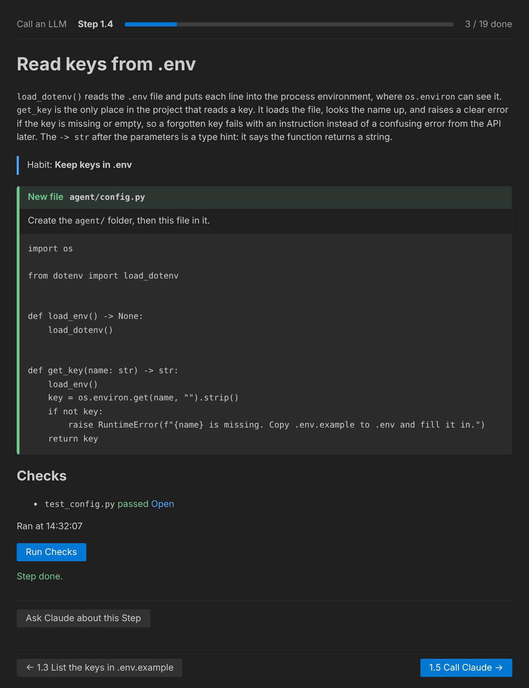
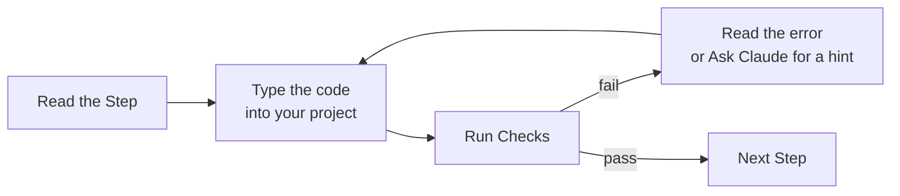

# touching grass

**Learn to build AI agents by typing the code yourself.**

[](https://github.com/zhongxuank/touching-grass/actions/workflows/ci.yml) [](LICENSE)

touching grass is a VS Code extension that walks you through building real AI projects one small Step at a time. Each Step explains a piece of code, you type it into your own project by hand, and a Check tells you it works. No AI writes the code for you: the extension only plays back lessons, and Claude is there as an optional tutor that gives hints, not answers.



## Why "touching grass"?

Coding agents are great, but after months of letting them write everything, it is easy to lose the feel for what the code actually does. "Touching grass" here means stepping away from autocomplete and writing the code by hand again, so the skills stay yours. The first Tracks teach the thing most of us now use every day but rarely build ourselves: AI agents.

## How it works



- **Tracks, Lessons, Steps.** A Track builds one project (for example, an AI agent). It is split into Lessons, and each Lesson into short Steps.
- **You type, it never pastes.** Each Step shows a Code Chunk and the file it goes in. You type it, which is the point.
- **Checks are visible pytest tests.** Press **Run Checks** to see whether your code works. You can open every Check to read what it tests.
- **Habits.** Each Track calls out a few good practices (keep keys in `.env`, handle API errors, commit after each Lesson) at the Step where they matter.
- **Your code is yours.** Everything you write lives in your own folder, a normal Python project you can keep using after the Track.

## Tracks

The Tracks come with the extension. They build one Python project, in order, so each starts where the last one ended.

| Track | What you build | Lessons |
| --- | --- | --- |
| **Build an AI agent from scratch** | Call Claude, OpenAI or OpenRouter with the official SDKs, add retries, then give the model tools and write the agent loop yourself | Call an LLM, Tool calling (19 Steps) |
| **Build a RAG assistant** | Turn three PDF articles (they come with the Track) into notes, search them by keyword, then by meaning with local embeddings, then answer with cited sources and a `search_notes` tool | Retrieval by hand, Embeddings, Answer with sources (21 Steps) |
| **Build a chatbot** | A Streamlit chat page on top of your agent, with streaming replies, settings and visible tool calls | A chat page, Streaming and settings, Tools in the chat (21 Steps) |

You can also write your own Track: see [Write your own Track](#write-your-own-track).

## Quick start

It takes about 15 minutes.

### 1. Install the tools

| Tool | Why | Install |
| --- | --- | --- |
| [VS Code](https://code.visualstudio.com/) 1.90+ | Runs the extension | Download from the site |
| [uv](https://docs.astral.sh/uv/) | Runs your Python and the Checks. It installs Python for you | macOS / Linux: `curl -LsSf https://astral.sh/uv/install.sh \| sh`<br>Windows: `powershell -ExecutionPolicy ByPass -c "irm https://astral.sh/uv/install.ps1 \| iex"` |
| [git](https://git-scm.com/) | The Tracks commit your work after each Lesson | Download from the site, or your package manager |
| [Claude Code](https://code.claude.com/docs) (optional) | Your tutor: answers questions about the Step you are on | `npm install -g @anthropic-ai/claude-code`, then run `claude` once to sign in |

Check them in a new terminal: `code --version`, `uv --version`, `git --version`, and `claude --version` if you installed it.

### 2. Install the extension

Download `touching-grass.vsix` from the [latest release](https://github.com/zhongxuank/touching-grass/releases/latest), then install it:

```sh
code --install-extension touching-grass.vsix
```

Or, in VS Code, open the command palette (Ctrl+Shift+P, or Cmd+Shift+P on macOS) and run **Extensions: Install from VSIX...**. If `code` is not found, run **Shell Command: Install 'code' command in PATH** from the command palette first.

<details>
<summary>Build it from source instead (needs Node.js 22+)</summary>

```sh
git clone https://github.com/zhongxuank/touching-grass
cd touching-grass
npm ci
npm run package
code --install-extension touching-grass.vsix
```

To update later, run `git pull && npm ci && npm run package` and install the new `touching-grass.vsix` the same way.

</details>

### 3. Get one API key

You need a key for one Provider, not all three. Steps for the Providers you have no key for are read-only, and their Checks are skipped. The first Lesson shows you where the key goes: a `.env` file in your project folder that git ignores.

| Provider | Cost for a Track | Notes |
| --- | --- | --- |
| [Anthropic (Claude)](https://console.anthropic.com/settings/keys) | A few cents. Claude Haiku 5.5 is $0.10 / $0.50 per million input / output tokens, roughly $0.0004 a call here, so $1 covers about 2,000 calls | Recommended |
| [OpenAI](https://platform.openai.com/api-keys) | A few cents with `gpt-4o-mini` | |
| [OpenRouter](https://openrouter.ai/keys), paid | A few cents with the default `openai/gpt-4o-mini` | One key for many models |
| [OpenRouter](https://openrouter.ai/keys), free | $0 | See below |

A Track makes roughly 50 to 150 calls, so the smallest top-up a Provider allows is plenty. Most Checks use a fake model and cost nothing. In the agents Track, a few also make one real call to prove your key and code work. The RAG and chatbot Checks never call the API. These numbers are estimates from November 2026, so check the Provider's pricing page.

Keep it safe: create a key just for this, set a monthly spend limit in the Provider's console, never commit `.env`, and revoke the key when you are done.

<details>
<summary>Use OpenRouter's free models</summary>

OpenRouter has free models, with ids ending in `:free`. Put one in your project folder's `.env`:

```sh
OPENROUTER_API_KEY=sk-or-...
OPENROUTER_MODEL=nvidia/nemotron-3.5-super-vl:free
```

Pick a free model that supports tool calling (filter by "Tools" on [openrouter.ai/models](https://openrouter.ai/models?max_price=0)), or the agent in Lesson 2 will not work. Free models allow 20 requests a minute and 50 a day (1,000 a day once you have bought $10 of credits), may be slower or less reliable, and can be withdrawn. Their providers may log prompts, so send nothing private. If a Check that calls the real API fails, try again or set `OPENROUTER_MODEL` back to empty to use the paid default.

</details>

### 4. Start a Track

1. Make an empty folder for your project, for example `~/my-agent`, and open it in VS Code (**File > Open Folder**). You work in this window from now on.
2. Open the command palette and run **Touching Grass: Open Track**. Pick **Build an AI agent from scratch**.
3. Read the first Step, then press **Run Checks**. When it asks where you will write your code, pick **Use this window's folder**.

Then repeat: read the Step, type the Code Chunk into the file it names, press **Run Checks**, move on. Your progress is saved in the project folder, and the Track reopens where you left off the next time you open that folder.

When you finish a Track, start the next one in the same folder with the **Open Track** button (the book icon) at the top of the Track sidebar. Your progress in each Track is kept, so you can switch back at any time.

To go through a Track again, open the **...** menu at the top of the Track sidebar and pick **Reset Progress in This Track**. It only resets the Steps' progress: your code files stay as they are, and other Tracks keep their progress.

## Ask Claude when you are stuck (optional)

Press **Ask Claude about this Step** at the bottom of any Step. Claude Code opens in your project folder with the Step you are on and your last Check results, and acts as a tutor, not a pair programmer: it explains, points to the cause of a failing Check, and gives a hint before a fix. It is told never to type the Code Chunk for you or to show the values in `.env`.

<details>
<summary>How the tutor is set up</summary>

How the button opens Claude is set by `touchingGrass.tutor.open`:

- `auto` (default): if the Claude Code VS Code extension is installed, its chat opens and the question is copied to your clipboard, so paste it in. Otherwise a terminal opens.
- `extension`: always use the Claude Code extension's chat. If it is not installed, an error names this setting.
- `terminal`: always open a terminal called "Claude tutor" in your project folder, which starts Claude Code there and asks it to read the Step you are on.

When you choose your project folder, the extension writes two files there for Claude Code to read:

- `.touching-grass/tutor.md` tells Claude how to help.
- `.touching-grass/current-step.md` is the Step you are on, with your last Check results. It is rewritten each time you open a Step or run its Checks.

It also adds one line, `@.touching-grass/tutor.md`, to `CLAUDE.md` in your project folder, creating the file if you have none and otherwise keeping what you wrote. Delete the line to turn the tutor guide off.

</details>

## Write your own Track

A Track is plain Markdown plus pytest files, so you can read, edit and review every word. A Step can also give the Learner a **Run it** button for a command, or a **Copy the files** button for input they should not type, such as the RAG Track's PDFs. The format is in [docs/track-format.md](docs/track-format.md).

To draft one, run the project skill in [Claude Code](https://code.claude.com/docs) from a clone of this repo:

```
/draft-track build a CLI to-do list in Python, 2 Lessons
```

It asks a few questions, plans the Lessons and Steps, writes `track.md`, `lessons/` and `checks/`, and runs `npm run validate-track` until it passes. The result is a draft: review and edit it before you follow it. [examples/todo-track](examples/todo-track) is a drafted Track with its reference solution.

To follow a Track that is not built in, run **Touching Grass: Open Track** and choose its folder.

## Develop

Requires Node.js 22+ and VS Code 1.90+.

```sh
npm ci
npm run build
```

Open this folder in VS Code and press F5 (the "Run Extension" launch config builds first). In the Extension Development Host, run **Touching Grass: Open Track** and pick a Track folder, for example `examples/sample-track`.

```sh
npm run typecheck   # tsc, strict
npm test            # vitest engine unit tests
npm run validate-track -- <folder>  # check a Track folder (after npm run build)
npm run test:smoke  # builds, then launches VS Code and checks the extension opens a fixture Track (downloads VS Code on first run)
```

The design is written down in [CONTEXT.md](CONTEXT.md) (the vocabulary) and [docs/adr/](docs/adr) (the decisions). The short version: Tracks are drafted ahead of time as reviewable files, and the extension is a player with no LLM inside it.

## License

[MIT](LICENSE)
